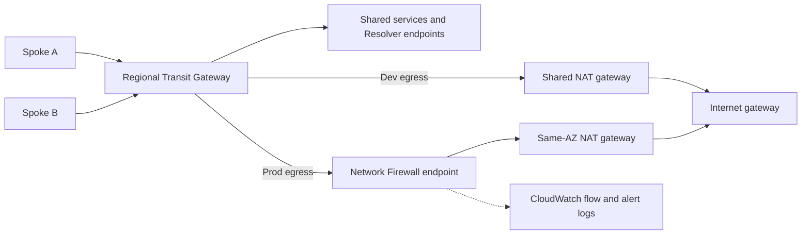

# AWS network reference

A Terraform example for a regional hub-and-spoke network. Both targets use the same [stack](stack) with separate inputs and state. Run the example on demand and destroy it when finished.

| | Dev | Prod |
| --- | --- | --- |
| AWS Region | `us-west-2` | `us-east-1` |
| Spoke-to-spoke traffic | Routes available, subject to workload security groups | Peer CIDRs are blackholed |
| IPv4 internet egress | Central public NAT gateway shared by both AZs | AZ-local Network Firewall endpoints and public NAT gateways |
| DNS | Private zone and an optional inbound/outbound Resolver example | Private zone, with Resolver endpoints available through inputs |
| Firewall logs | None | CloudWatch flow and alert log groups |

The four VPCs represent two workload accounts, shared services and central egress. They deploy in the same AWS account. Each VPC has its own Transit Gateway attachment and associated route table.

## Follow the traffic



- **Spoke to shared services.** The spoke subnet sends traffic to Transit Gateway. The spoke's TGW route table learns the shared VPC CIDR through propagation. The shared VPC sends traffic for either spoke back through TGW, where the shared attachment's table has both spoke CIDRs. In prod, each spoke's explicit peer blackhole takes precedence over its default egress route.
- **Private DNS.** Spoke A and shared services resolve records through their VPC Resolver and associated private hosted zone. With the optional endpoints enabled, a DNS server in spoke B can forward queries for that zone to the shared inbound endpoint IPs. A separate forwarding rule sends queries for a different suffix from spoke A and shared services through the outbound endpoint to your DNS server in spoke B. Allow TCP and UDP port 53 from the outbound endpoint subnets on that server.
- **Internet egress.** In dev the egress attachment subnets route directly to the public NAT gateway. In prod each egress attachment subnet sends outbound traffic to its AZ's firewall endpoint, which sends permitted traffic to the NAT gateway in the same AZ. After translation, return traffic for the spokes routes from the NAT subnet back through that firewall endpoint and then through TGW. Appliance mode keeps the inspection path symmetric. Prod allows TCP 443 for the configured TLS SNI names. Its strict-order policy uses application-aware, server-directed drop and alert defaults so segmented TLS ClientHello packets can reach SNI evaluation while server responses remain allowed. Unmatched client traffic is dropped and logged. The firewall covers internet egress routed through it. Queries to AmazonProvidedDNS use the VPC Resolver path. [AWS centralized egress design](https://docs.aws.amazon.com/whitepapers/latest/building-scalable-secure-multi-vpc-network-infrastructure/centralized-egress-to-internet.html) · [AWS Network Firewall rule ordering](https://docs.aws.amazon.com/network-firewall/latest/developerguide/suricata-rule-evaluation-order.html)

The module creates networking infrastructure. To connect a service, place it in a workload subnet, configure its security groups and add its address to `private_records`. The Resolver example expects you to supply the DNS server in spoke B. The example IPs in the variable files illustrate where those services would go.

## Set your inputs

Run [00-bootstrap](../00-bootstrap/README.md) first to create the regional S3 buckets and GitHub OIDC roles. Install Terraform 1.17.x. From the repository root:

```bash
cd projects/01-network/deployments/region
target=dev  # Use prod for the Virginia example.
cp "$target.example.tfvars.json" "$target.tfvars.json"
cp "$target.example.tfbackend" "$target.tfbackend"
```

Set your account ID, resource prefix, two AZs, non-overlapping VPC CIDRs and private DNS values in `"$target.tfvars.json"`. Terraform divides each VPC CIDR into subnets using the input AZ order. Supply real service IPs where applicable. To omit the paid Resolver endpoints, remove the `resolver` object. Set prod's exact HTTPS server names and CloudWatch log retention in `network.firewall`.

In `"$target.tfbackend"`, set the bucket from bootstrap's `state_backends` output and the expected AWS account ID. Each target uses a different key. The root enables S3 encryption and lockfiles. Terraform initializes the backend before reading tfvars, so keep backend values in the separate ignored file. Git ignores both real input files. Keep AWS credentials in your AWS profile locally and use OIDC in GitHub Actions. [Terraform S3 backend configuration](https://developer.hashicorp.com/terraform/language/backend/s3)

## Validate without AWS

From the repository root, with Terraform 1.17.x installed:

```sh
terraform fmt -recursive -check projects/01-network
cd projects/01-network/deployments/region
terraform init -backend=false -input=false -lockfile=readonly
terraform validate
terraform test
```

The [tests](deployments/region/tests) use mock providers and synthetic inputs to plan both examples and check the TLS policy and disabled-firewall behavior. Initialization downloads the locked AWS provider but does not initialize S3. These checks do not call AWS or verify real packet handling. Live acceptance still needs routing, DNS, allowed/blocked TLS (including a segmented ClientHello), and teardown checks in your account.

Local verification, November 16, 2026: formatting, Terraform validation and all four mock tests passed with Terraform 1.17.2 and AWS provider 6.72.0. The Actions workflow passed actionlint 1.7.7 and its shell steps passed `bash -n`. No real AWS deployment or packet tests were run.

## Run locally

With the AWS profile for the target account selected, run the commands below from `deployments/region/`. Set the shell's `target` first and use a separate Terraform data directory for each target.

```bash
export TF_DATA_DIR=".terraform/$target"
terraform init -reconfigure -backend-config="$target.tfbackend"
terraform validate
terraform plan -var-file="$target.tfvars.json" -out="$target.tfplan"
terraform apply "$target.tfplan"
```

## Run from GitHub Actions

The [workflow](../../.github/workflows/network.yml) uses the bootstrap role for the selected target. Configure these **repository secrets** in the repository whose OIDC subjects you supplied to bootstrap:

| Secrets | Value |
| --- | --- |
| `NETWORK_DEV_TFVARS`, `NETWORK_PROD_TFVARS` | Contents of each target's ignored `.tfvars.json` |
| `NETWORK_DEV_BACKEND`, `NETWORK_PROD_BACKEND` | Contents of each target's ignored `.tfbackend` |
| `NETWORK_DEV_ROLE_ARN`, `NETWORK_PROD_ROLE_ARN` | Matching values from bootstrap's `github_actions_role_arns` output |

The bootstrap roles initially have S3 backend access only. Before dispatching, have your AWS administrator extend the matching roles in bootstrap with the permissions required to create, read, update, tag and delete this project's resources. Dev needs EC2 VPC, TGW and NAT permissions and Route 53 hosted zone permissions, plus Resolver permissions if enabled. Prod also needs Network Firewall and CloudWatch Logs permissions, including log delivery. In a fresh account, have the administrator provision the AWS service-linked roles required by the enabled services or allow their creation for those services. Scope regional permissions to the target region and scope IAM and Route 53 permissions separately. [AWS service authorization reference](https://docs.aws.amazon.com/service-authorization/latest/reference/reference_policies_actions-resources-contextkeys.html) · [Network Firewall logging permissions](https://docs.aws.amazon.com/network-firewall/latest/developerguide/firewall-logging-permissions.html)

Once the workflow is on the default branch, choose **Actions → Network infrastructure → Run workflow** and select the target and operation. Dev uses bootstrap's branch trust. Prod uses `main`. The workflow applies the plan from the same run for `apply` and `destroy`. It keeps full Terraform output and the saved plan on the ephemeral runner. To inspect detailed changes or errors, plan locally with the same files.

## Tear down

Delete any workloads or other resources you attached to these VPCs. Dispatch `destroy` for the same target, or run `terraform destroy -var-file="$target.tfvars.json"` locally with that target's backend initialized. Keep the bootstrap buckets and roles until both network targets are removed. Teardown deletes the example firewall log groups.

Transit Gateway attachments, NAT gateways, Resolver endpoints and Network Firewall incur charges while provisioned. Check AWS pricing for the selected regions before deploying. [AWS Transit Gateway](https://aws.amazon.com/transit-gateway/pricing/) · [Amazon VPC](https://aws.amazon.com/vpc/pricing/) · [Route 53](https://aws.amazon.com/route53/pricing/) · [AWS Network Firewall](https://aws.amazon.com/network-firewall/pricing/)
